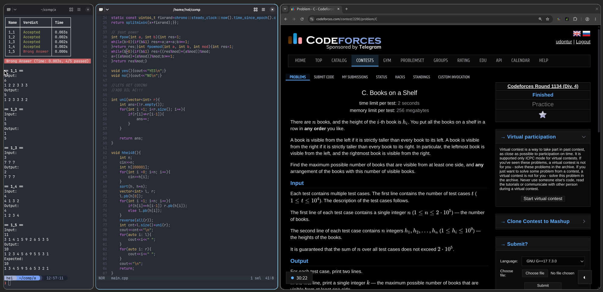

# 🧠 Competitive Programming Template
My C++ competitive programming template, since grade 8. 

The curated [resource list](RESOURCE.md) has links to competitive programming tutorials, math resources, C++ things, online judges, and tools.

## My current setup

